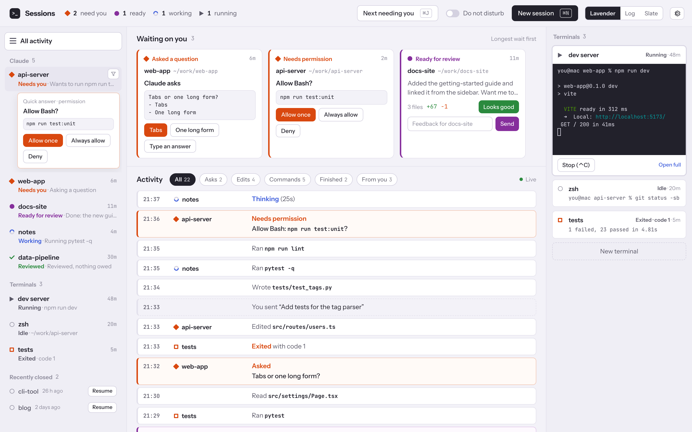
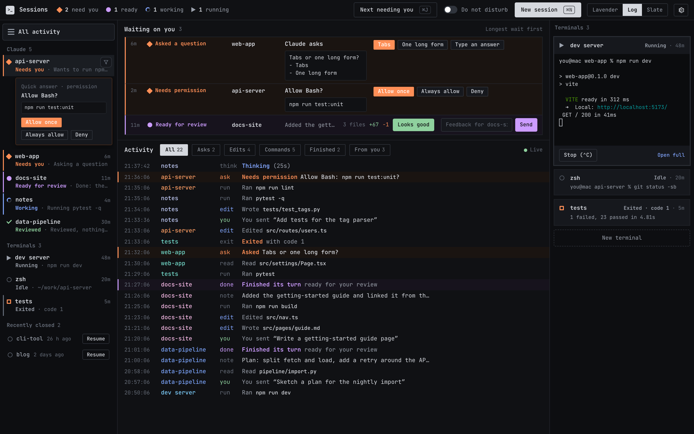
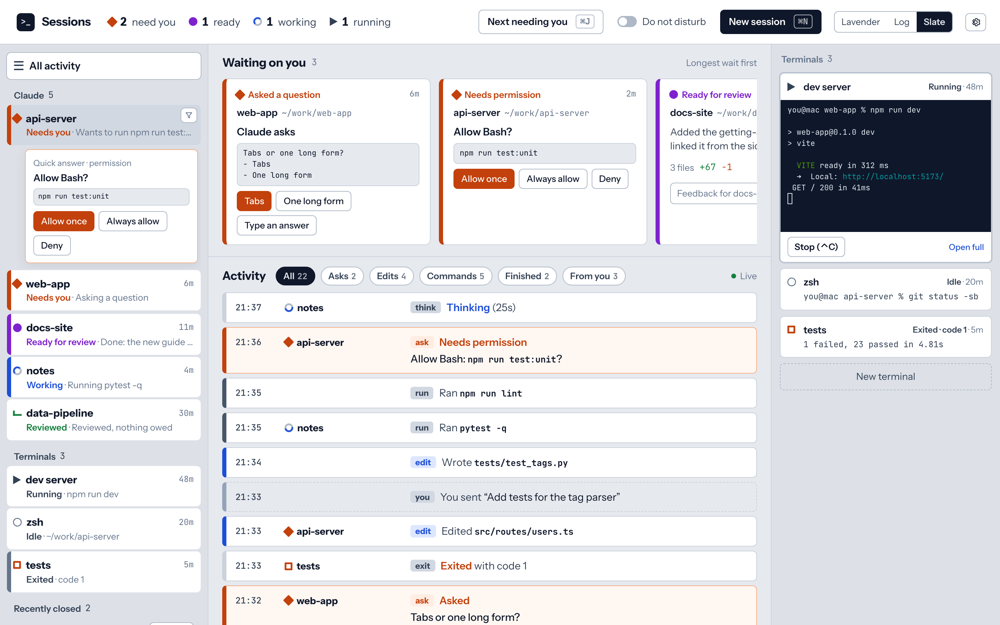
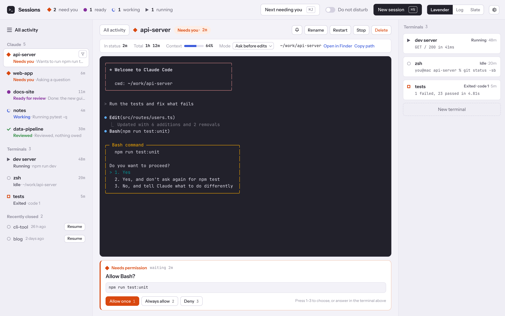
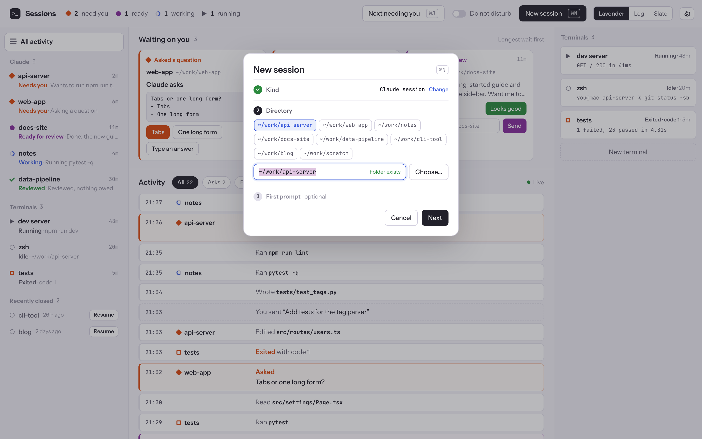
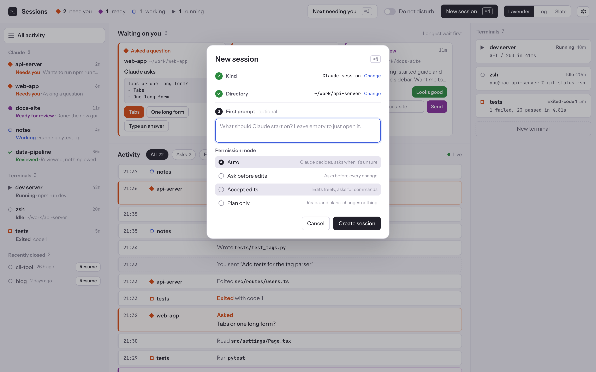
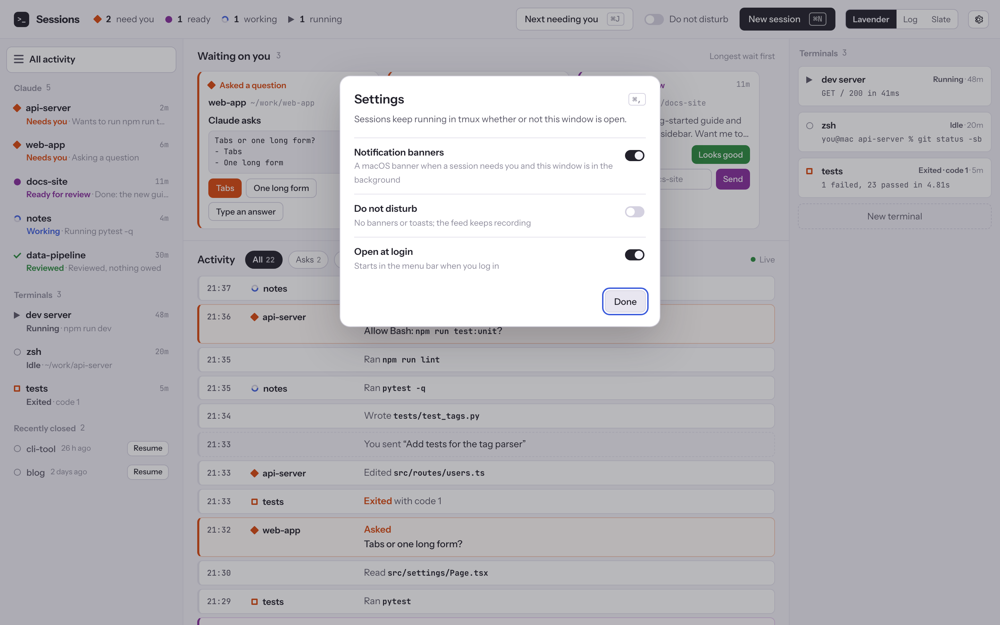

# Terminal Manager

A macOS menu bar app that runs all your terminals in one window. Every session is either a
[Claude Code](https://docs.claude.com/en/docs/claude-code) session or a plain zsh terminal in a folder
you pick. The window shows which Claude sessions are working, which need you (a permission prompt or a
question) and which are ready for review, and you can create, answer, type into and delete them all from
there. No terminal windows pile up on the desktop: each session lives in a private tmux server and is
drawn in the window with xterm.js, so sessions keep running when the window is closed or the app quits.



| Log | Slate |
| --- | --- |
|  |  |

A session that needs you, with its real terminal and the ask card:



New session: pick a folder (every folder in `~/work`, most recently used first, a typed path or the
Finder), an optional first prompt and a permission mode:

| Folder | Prompt and mode |
| --- | --- |
|  |  |

Settings (also in the menu bar dropdown):



The screenshots use demo sessions from the mock native bridge in `app/web/test/`.

## What it does

- **Menu bar item.** A plus sign: plain when nothing is going on, orange when a session needs you, green
  when something is ready for review. Its dropdown lists those sessions, New Claude session…, New
  terminal…, Open window, Open at login, Settings… and Quit. No Dock icon.
- **Live statuses from Claude Code hooks.** The app adds its own small plugin to every Claude session it
  starts. Working, Needs you, Ready for review, Reviewed ("Looks good"), Exited.
- **Answer from the app.** Permission prompts and questions can be answered from the Waiting on you
  lane, the list row or the session's ask card, or in the terminal itself. The buttons only appear when
  the card shows everything they approve; anything else is answered in the terminal.
- **Activity feed** of prompts, tool calls, asks and answers, finished turns and Claude's replies, with
  filters. Changed files and +/− on every finished turn.
- **Real terminals** in the main pane and in the tray, a composer that types into the session, rename,
  restart, stop and delete.
- **Resume.** Each Claude session's conversation id is stored. When its tmux session is gone (after a
  reboot) it comes back with `claude --resume` in the same folder and mode; deleted sessions wait in
  Recently closed.
- **Notifications** as macOS banners when a session needs you and the window is in the background, a
  per-session bell and Do not disturb.
- Three stylings: Lavender, Log and Slate.

## Requirements

- macOS 13 or later (Apple silicon or Intel)
- [tmux](https://github.com/tmux/tmux) from Homebrew (`brew install tmux`) or MacPorts
- [Claude Code](https://docs.claude.com/en/docs/claude-code) on your login shell's PATH
- Xcode command line tools with Swift 5.10 or later, to build

## Build and install

```sh
git clone <this repo> terminal-manager
cd terminal-manager/app
scripts/install.sh      # builds, installs to ~/Applications/Terminal Manager.app and opens it
```

The first launch turns Open at login on (switch it off in Settings). `scripts/build.sh` only builds
`app/build/Terminal Manager.app`; it is ad-hoc signed unless `TM_SIGN_IDENTITY` names a codesign
identity.

For development: `scripts/run-dev.sh` runs a debug build against `app/web`, and `swift test` runs the
unit tests. `docs/HANDOFF.md` explains the architecture.

## License

MIT, see [LICENSE](LICENSE). xterm.js and its fit addon are MIT licensed; their license files are in
`app/web/vendor/xterm/`.
