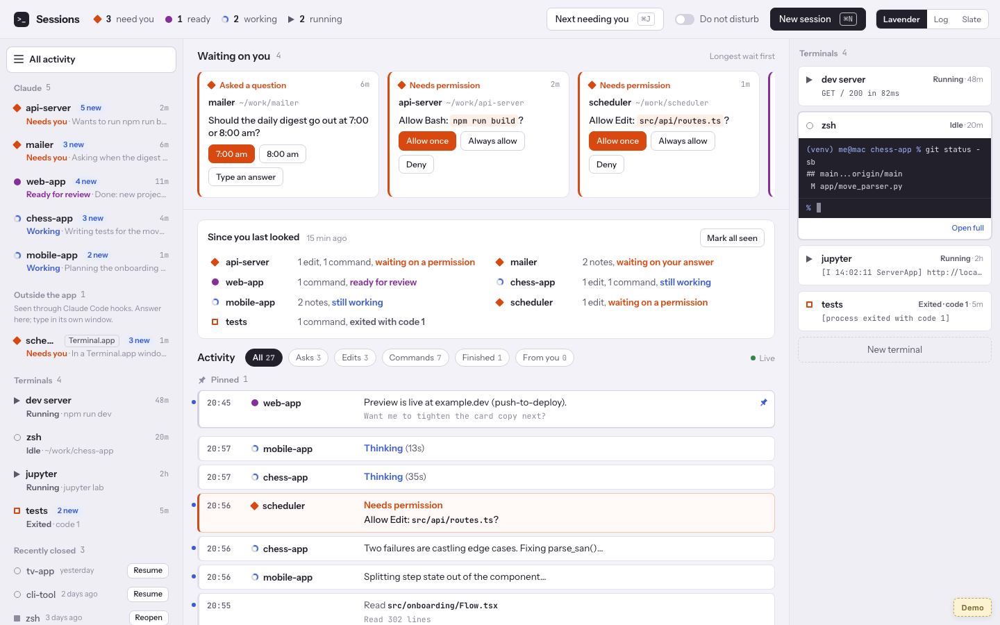

# Design

The design work behind the app, kept as plain HTML you can open straight from disk.

- `prototype/index.html` is the clickable prototype the app was built from. The backend is fake, but every button works: talk to sessions, answer prompts, run fake shell commands, create and delete sessions, and switch between the three stylings (Lavender, Log, Slate). The Demo button in the corner fires events on demand.
- `board/index.html` is the design board: the annotated main screen, key states, the three stylings, the interaction notes and the trade-offs.

All sessions and projects in the mock data are made up.

